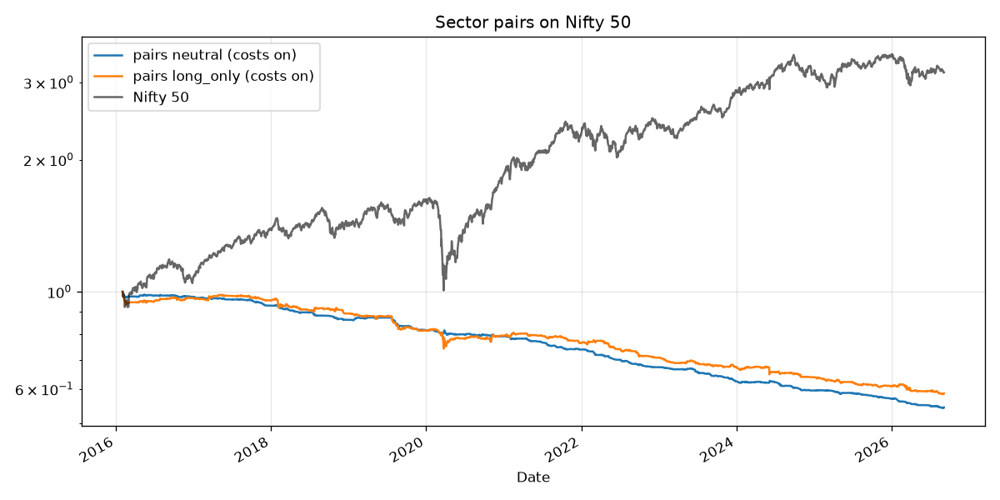

# Pairs trading on Nifty 50 (2026-09-06)

Sector-constrained pairs, formation 252d re-run every 6 months, z-score window 60d, enter |z|>2, exit |z|<0.5, stop |z|>4, max hold 40d, 8 pairs. Costs: india_delivery per side on every leg.

## Full period, default parameters

| mode      | costs          |   CAGR % |   Sharpe |   MaxDD % |   ann vol % |   turnover/yr |   cost drag % total |   bench CAGR % |   bench MaxDD % |
|:----------|:---------------|---------:|---------:|----------:|------------:|--------------:|--------------------:|---------------:|----------------:|
| neutral   | india_delivery |    -5.68 |    -3.08 |    -45.74 |        1.89 |          41.1 |               81.25 |           11.7 |          -38.44 |
| neutral   | zero           |     1.99 |     1.06 |     -3.03 |        1.87 |          41.1 |                0    |           11.7 |          -38.44 |
| long_only | india_delivery |    -5.01 |    -1.12 |    -41.64 |        4.51 |          41.4 |               81.8  |           11.7 |          -38.44 |
| long_only | zero           |     2.77 |     0.63 |    -11.16 |        4.49 |          41.4 |                0    |           11.7 |          -38.44 |

## Walk-forward on thresholds (long_only mode), OOS 2019-01-01 to 2026-09-04

OOS CAGR **-1.2%**, Sharpe **-0.24**, MaxDD **-15.34%** | Nifty same period: CAGR 11.02%, Sharpe 0.69, MaxDD -38.44%

| train     |   test | chosen                                                            |   train_sharpe |   test_sharpe |   test_cagr_pct |   test_maxdd_pct |   default_test_sharpe |
|:----------|-------:|:------------------------------------------------------------------|---------------:|--------------:|----------------:|-----------------:|----------------------:|
| 2016-2018 |   2019 | {'mode': 'long_only', 'entry': 2.5, 'exit': 0.25, 'max_hold': 20} |          -0.63 |         -1.75 |           -4.61 |            -4.5  |                 -2.38 |
| 2017-2019 |   2020 | {'mode': 'long_only', 'entry': 1.5, 'exit': 0.25, 'max_hold': 20} |          -0.74 |         -0.07 |           -1.41 |           -11.66 |                 -0.25 |
| 2018-2020 |   2021 | {'mode': 'long_only', 'entry': 2.5, 'exit': 0.25, 'max_hold': 20} |          -0.31 |          0.77 |            1.22 |            -1.19 |                 -1.39 |
| 2019-2021 |   2022 | {'mode': 'long_only', 'entry': 2.5, 'exit': 0.25, 'max_hold': 20} |          -0.19 |          0.16 |            0.33 |            -1.87 |                 -2.45 |
| 2020-2022 |   2023 | {'mode': 'long_only', 'entry': 2.5, 'exit': 0.25, 'max_hold': 20} |           0.11 |          0.03 |            0.03 |            -1.44 |                 -2.19 |
| 2021-2023 |   2024 | {'mode': 'long_only', 'entry': 2.5, 'exit': 0.25, 'max_hold': 20} |           0.3  |          0.02 |            0.01 |            -2.16 |                 -1.23 |
| 2022-2024 |   2025 | {'mode': 'long_only', 'entry': 2.5, 'exit': 0.25, 'max_hold': 20} |           0.06 |         -1.77 |           -2.41 |            -2.71 |                 -2.03 |
| 2023-2025 |   2026 | {'mode': 'long_only', 'entry': 2.5, 'exit': 0.25, 'max_hold': 20} |          -0.38 |         -1.51 |           -3.33 |            -2.82 |                 -1.46 |

Plateau: median_sharpe=-1.12, best_sharpe=-0.33, pct_grid_above_benchmark=0.0, half_to_half_rank_corr=0.64, default_sharpe=-1.12, default_rank_of_18=9

## What this means

* `neutral` is the true stat-arb book. Its return is what you get **before** the cost of borrowing/shorting, which in India means stock futures (lot size Rs 5-10 lakh each) and in the US a margin account. It cannot be run with Rs 50k. It is here so we know the size of the prize before we ever pay for that infrastructure.
* `long_only` is runnable today. It is a relative-value rotation, not an arbitrage: it carries full market beta.
* Judge both by Sharpe and drawdown vs. the trend book, not by CAGR alone. Turnover and cost drag tell you why stat-arb is a game for people paying 1 bp, not 19.

## Conclusion (6 Sep 2026): pairs is retired at retail cost levels

* Gross of costs the market-neutral book is a real but tiny edge: about 2% a year at 2% volatility (Sharpe 1.06, max drawdown 3%). That is the kind of return a prop desk levers 10x at 1 bp per side.
* At India delivery costs (19 bps per side) and 41x annual turnover the same book loses 5.7% a year. Break-even cost is roughly 2.5 bps per side, which no retail broker offers.
* The long-only variant is negative both in-sample and out-of-sample, and no threshold in the grid beats the Nifty.
* Decision: `pairs` stays in the registry for research, is excluded from every paper and live book, and is revisited only if we ever get futures capital plus institutional-grade costs. Trend and momentum remain the engine.
