# Walk-forward & parameter-plateau report (2026-09-06)

Train 3y / test 1y rolling, parameters chosen on train Sharpe only, scored on the following test year. Costs on. Data from 2015-01-01. Survivorship bias applies to the stock universes (today's members).
| universe   | strategy   |   OOS CAGR % |   OOS Sharpe |   OOS MaxDD % |   Bench CAGR % (same period) |   Bench Sharpe |   Bench MaxDD % |   grid median Sharpe |   % grid > bench |   half/half rank corr | default rank   |
|:-----------|:-----------|-------------:|-------------:|--------------:|-----------------------------:|---------------:|----------------:|---------------------:|-----------------:|----------------------:|:---------------|
| nifty50    | momentum   |        10.72 |         0.6  |        -42.17 |                        10.1  |           0.66 |          -38.44 |                 0.9  |            100   |                 -0.12 | 14/36          |
| nifty50    | trend      |        14.66 |         0.93 |        -31.14 |                        10.1  |           0.66 |          -38.44 |                 0.95 |            100   |                  0.58 | 16/33          |
| nifty50    | meanrev    |       -10.76 |        -0.45 |        -65.98 |                        10.1  |           0.66 |          -38.44 |                -0.75 |              0   |                  0.79 | 8/27           |
| india_etf  | momentum   |        14.6  |         1.12 |        -29.56 |                        10.1  |           0.66 |          -38.44 |                 1.16 |            100   |                 -0.3  | 29/36          |
| india_etf  | trend      |        10.75 |         1.15 |        -11.47 |                        10.1  |           0.66 |          -38.44 |                 1.2  |            100   |                 -0.08 | 19/33          |
| india_etf  | meanrev    |        -3.23 |        -0.21 |        -42.23 |                        10.1  |           0.66 |          -38.44 |                -0.52 |              0   |                  0.73 | 16/27          |
| us_core    | momentum   |        16.69 |         0.85 |        -31.15 |                        14.74 |           0.82 |          -33.72 |                 1.17 |            100   |                 -0.01 | 36/36          |
| us_core    | trend      |        15.51 |         1.06 |        -17.21 |                        14.74 |           0.82 |          -33.72 |                 1.18 |            100   |                  0.57 | 5/33           |
| us_core    | meanrev    |        15.19 |         0.86 |        -27.31 |                        14.74 |           0.82 |          -33.72 |                 0.99 |             77.8 |                  0.26 | 10/27          |

## Universe `nifty50` (costs: india_delivery)

### momentum

Walk-forward OOS (2018-01-01 to 2026-09-04): CAGR **10.72%**, Sharpe **0.6**, MaxDD **-42.17%**  |  benchmark same period: CAGR 10.1%, Sharpe 0.66, MaxDD -38.44%

| train     |   test | chosen                                                             |   train_sharpe |   test_sharpe |   test_cagr_pct |   test_maxdd_pct |   default_test_sharpe |
|:----------|-------:|:-------------------------------------------------------------------|---------------:|--------------:|----------------:|-----------------:|----------------------:|
| 2015-2017 |   2018 | {'lookback': 252, 'skip': 21, 'top_n': 12, 'regime_filter': False} |           1.94 |          0.44 |            6.24 |           -13.07 |                  0.06 |
| 2016-2018 |   2019 | {'lookback': 252, 'skip': 21, 'top_n': 12, 'regime_filter': False} |           1.56 |          0.96 |           14.5  |           -12.81 |                 -0.16 |
| 2017-2019 |   2020 | {'lookback': 252, 'skip': 21, 'top_n': 12, 'regime_filter': False} |           1.62 |          0.59 |           14.84 |           -42.17 |                  1.64 |
| 2018-2020 |   2021 | {'lookback': 126, 'skip': 0, 'top_n': 12, 'regime_filter': True}   |           0.93 |          2.12 |           57.77 |           -11.19 |                  1.87 |
| 2019-2021 |   2022 | {'lookback': 189, 'skip': 21, 'top_n': 12, 'regime_filter': True}  |           1.85 |         -0.53 |           -8.55 |           -22.33 |                 -0    |
| 2020-2022 |   2023 | {'lookback': 126, 'skip': 21, 'top_n': 8, 'regime_filter': True}   |           1.58 |          0.66 |            8.39 |           -19.47 |                  2.07 |
| 2021-2023 |   2024 | {'lookback': 189, 'skip': 21, 'top_n': 12, 'regime_filter': False} |           1.7  |          0.99 |           20    |           -16.19 |                  1.01 |
| 2022-2024 |   2025 | {'lookback': 252, 'skip': 21, 'top_n': 5, 'regime_filter': False}  |           1.45 |          0.33 |            4.34 |           -17.95 |                 -0.06 |
| 2023-2025 |   2026 | {'lookback': 252, 'skip': 21, 'top_n': 5, 'regime_filter': False}  |           1.51 |         -0.67 |          -16.06 |           -18.22 |                 -1.33 |

Plateau: median_sharpe=0.9, best_sharpe=1.11, pct_grid_above_benchmark=100.0, half_to_half_rank_corr=-0.12, default_sharpe=0.93, default_rank_of_36=14

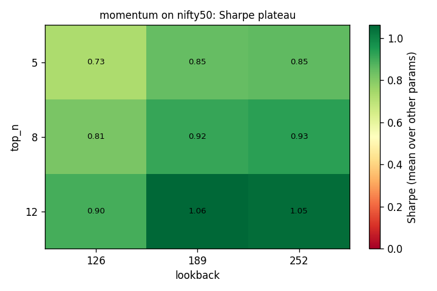

Top 5 parameter sets (full period):

|   lookback |   skip |   top_n | regime_filter   |   sharpe |   sharpe_h1 |   sharpe_h2 | is_default   |
|-----------:|-------:|--------:|:----------------|---------:|------------:|------------:|:-------------|
|        189 |      0 |      12 | False           |     1.11 |        1.23 |        0.98 | False        |
|        189 |     21 |      12 | False           |     1.09 |        1.07 |        1.1  | False        |
|        252 |     21 |      12 | False           |     1.08 |        1.06 |        1.09 | False        |
|        189 |      0 |      12 | True            |     1.05 |        1.36 |        0.78 | False        |
|        252 |      0 |      12 | True            |     1.05 |        1.22 |        0.89 | False        |

### trend

Walk-forward OOS (2018-01-01 to 2026-09-04): CAGR **14.66%**, Sharpe **0.93**, MaxDD **-31.14%**  |  benchmark same period: CAGR 10.1%, Sharpe 0.66, MaxDD -38.44%

| train     |   test | chosen                                         |   train_sharpe |   test_sharpe |   test_cagr_pct |   test_maxdd_pct |   default_test_sharpe |
|:----------|-------:|:-----------------------------------------------|---------------:|--------------:|----------------:|-----------------:|----------------------:|
| 2015-2017 |   2018 | {'fast': 100, 'slow': 250, 'max_weight': 0.2}  |           1.58 |          0.37 |            4.02 |           -14.46 |                  0.37 |
| 2016-2018 |   2019 | {'fast': 100, 'slow': 250, 'max_weight': 0.2}  |           1.32 |          1.27 |           16.17 |            -7.08 |                  0.98 |
| 2017-2019 |   2020 | {'fast': 50, 'slow': 250, 'max_weight': 0.2}   |           1.68 |          1.16 |           33.37 |           -31.14 |                  1.21 |
| 2018-2020 |   2021 | {'fast': 100, 'slow': 250, 'max_weight': 0.25} |           1.01 |          2.19 |           36.19 |            -9.4  |                  2.17 |
| 2019-2021 |   2022 | {'fast': 50, 'slow': 150, 'max_weight': 0.25}  |           1.45 |          0.26 |            2.97 |           -16.96 |                  0.31 |
| 2020-2022 |   2023 | {'fast': 100, 'slow': 200, 'max_weight': 0.25} |           1.33 |          2.44 |           24.62 |            -7.23 |                  2.55 |
| 2021-2023 |   2024 | {'fast': 100, 'slow': 200, 'max_weight': 0.2}  |           1.57 |          0.99 |           14.83 |           -11.72 |                  0.98 |
| 2022-2024 |   2025 | {'fast': 100, 'slow': 200, 'max_weight': 0.2}  |           1.13 |          0.5  |            5.86 |           -13.21 |                  0.24 |
| 2023-2025 |   2026 | {'fast': 100, 'slow': 250, 'max_weight': 0.2}  |           1.28 |         -0.39 |           -6.03 |           -13.17 |                 -0.51 |

Plateau: median_sharpe=0.95, best_sharpe=1.1, pct_grid_above_benchmark=100.0, half_to_half_rank_corr=0.58, default_sharpe=0.95, default_rank_of_33=16

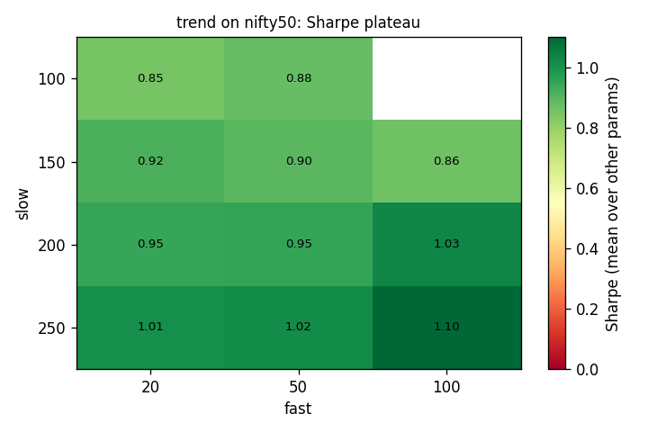

Top 5 parameter sets (full period):

|   fast |   slow |   max_weight |   sharpe |   sharpe_h1 |   sharpe_h2 | is_default   |
|-------:|-------:|-------------:|---------:|------------:|------------:|:-------------|
|    100 |    250 |         0.34 |     1.1  |        1.19 |        1.01 | False        |
|    100 |    250 |         0.25 |     1.1  |        1.19 |        1.01 | False        |
|    100 |    250 |         0.2  |     1.1  |        1.19 |        1.01 | False        |
|    100 |    200 |         0.2  |     1.03 |        1.06 |        1    | False        |
|    100 |    200 |         0.25 |     1.03 |        1.07 |        1    | False        |

### meanrev

Walk-forward OOS (2018-01-01 to 2026-09-04): CAGR **-10.76%**, Sharpe **-0.45**, MaxDD **-65.98%**  |  benchmark same period: CAGR 10.1%, Sharpe 0.66, MaxDD -38.44%

| train     |   test | chosen                                      |   train_sharpe |   test_sharpe |   test_cagr_pct |   test_maxdd_pct |   default_test_sharpe |
|:----------|-------:|:--------------------------------------------|---------------:|--------------:|----------------:|-----------------:|----------------------:|
| 2015-2017 |   2018 | {'oversold': 15, 'exit': 80, 'max_hold': 5} |           0.93 |          0.57 |            9.19 |           -13.34 |                 -0.64 |
| 2016-2018 |   2019 | {'oversold': 15, 'exit': 80, 'max_hold': 5} |           0.86 |          0.02 |           -1.21 |           -14.19 |                 -0.28 |
| 2017-2019 |   2020 | {'oversold': 15, 'exit': 80, 'max_hold': 5} |           0.96 |         -0.37 |          -15.63 |           -43.07 |                 -0.21 |
| 2018-2020 |   2021 | {'oversold': 15, 'exit': 80, 'max_hold': 7} |          -0.01 |         -0.41 |           -9.88 |           -19.12 |                 -0.23 |
| 2019-2021 |   2022 | {'oversold': 10, 'exit': 80, 'max_hold': 5} |          -0.13 |         -1.23 |          -24.68 |           -26.38 |                 -1.38 |
| 2020-2022 |   2023 | {'oversold': 10, 'exit': 80, 'max_hold': 5} |          -0.25 |          0.12 |            0.64 |           -11.22 |                 -0.55 |
| 2021-2023 |   2024 | {'oversold': 5, 'exit': 80, 'max_hold': 7}  |          -0.39 |         -0.61 |          -12.9  |           -23.68 |                 -0.59 |
| 2022-2024 |   2025 | {'oversold': 10, 'exit': 80, 'max_hold': 7} |          -0.41 |          0.22 |            2.28 |           -18.26 |                 -0.34 |
| 2023-2025 |   2026 | {'oversold': 10, 'exit': 80, 'max_hold': 5} |           0.01 |         -3.21 |          -43.44 |           -32.28 |                 -3.49 |

Plateau: median_sharpe=-0.75, best_sharpe=-0.14, pct_grid_above_benchmark=0.0, half_to_half_rank_corr=0.79, default_sharpe=-0.5, default_rank_of_27=8

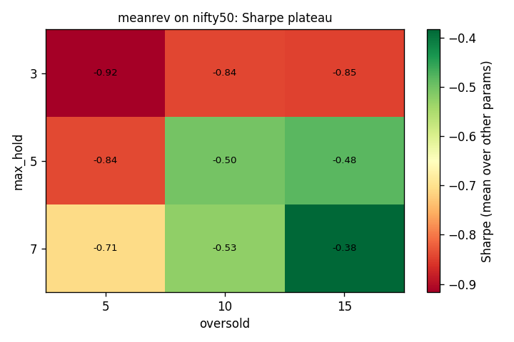

Top 5 parameter sets (full period):

|   oversold |   exit |   max_hold |   sharpe |   sharpe_h1 |   sharpe_h2 | is_default   |
|-----------:|-------:|-----------:|---------:|------------:|------------:|:-------------|
|         15 |     80 |          7 |    -0.14 |        0.27 |       -0.65 | False        |
|         15 |     80 |          5 |    -0.23 |        0.26 |       -0.84 | False        |
|         10 |     80 |          5 |    -0.28 |        0.01 |       -0.66 | False        |
|         15 |     70 |          7 |    -0.37 |        0.03 |       -0.89 | False        |
|         10 |     80 |          7 |    -0.38 |       -0.15 |       -0.67 | False        |

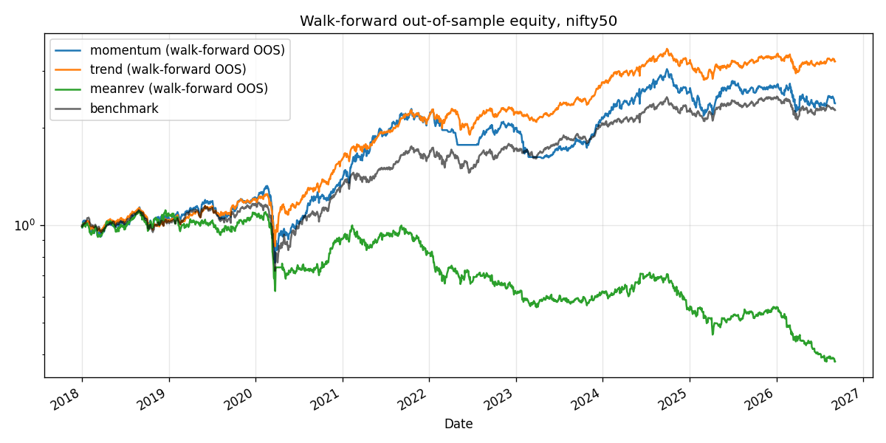

## Universe `india_etf` (costs: india_delivery)

### momentum

Walk-forward OOS (2018-01-01 to 2026-09-04): CAGR **14.6%**, Sharpe **1.12**, MaxDD **-29.56%**  |  benchmark same period: CAGR 10.1%, Sharpe 0.66, MaxDD -38.44%

| train     |   test | chosen                                                           |   train_sharpe |   test_sharpe |   test_cagr_pct |   test_maxdd_pct |   default_test_sharpe |
|:----------|-------:|:-----------------------------------------------------------------|---------------:|--------------:|----------------:|-----------------:|----------------------:|
| 2015-2017 |   2018 | {'lookback': 252, 'skip': 0, 'top_n': 5, 'regime_filter': False} |           2.02 |          0.14 |            0.94 |           -10.98 |                  0.38 |
| 2016-2018 |   2019 | {'lookback': 252, 'skip': 0, 'top_n': 5, 'regime_filter': False} |           1.51 |          2.02 |           20.34 |            -4.67 |                  0.19 |
| 2017-2019 |   2020 | {'lookback': 126, 'skip': 0, 'top_n': 5, 'regime_filter': False} |           1.74 |          1.02 |           22.03 |           -29.56 |                  1.32 |
| 2018-2020 |   2021 | {'lookback': 126, 'skip': 0, 'top_n': 5, 'regime_filter': False} |           0.95 |          2.16 |           31.34 |            -6.23 |                  1.95 |
| 2019-2021 |   2022 | {'lookback': 126, 'skip': 0, 'top_n': 5, 'regime_filter': False} |           1.48 |         -0.23 |           -4.09 |           -18.31 |                 -0.92 |
| 2020-2022 |   2023 | {'lookback': 126, 'skip': 0, 'top_n': 5, 'regime_filter': False} |           0.94 |          2.26 |           21.64 |            -6.7  |                  2.47 |
| 2021-2023 |   2024 | {'lookback': 126, 'skip': 0, 'top_n': 8, 'regime_filter': False} |           1.32 |          2.18 |           24.79 |            -5.64 |                  2.18 |
| 2022-2024 |   2025 | {'lookback': 126, 'skip': 0, 'top_n': 8, 'regime_filter': False} |           1.31 |          1.33 |           15.77 |           -10.07 |                  1.63 |
| 2023-2025 |   2026 | {'lookback': 126, 'skip': 0, 'top_n': 8, 'regime_filter': True}  |           2.09 |          0.01 |           -0.54 |           -11.71 |                  0.01 |

Plateau: median_sharpe=1.16, best_sharpe=1.3, pct_grid_above_benchmark=100.0, half_to_half_rank_corr=-0.3, default_sharpe=1.14, default_rank_of_36=29

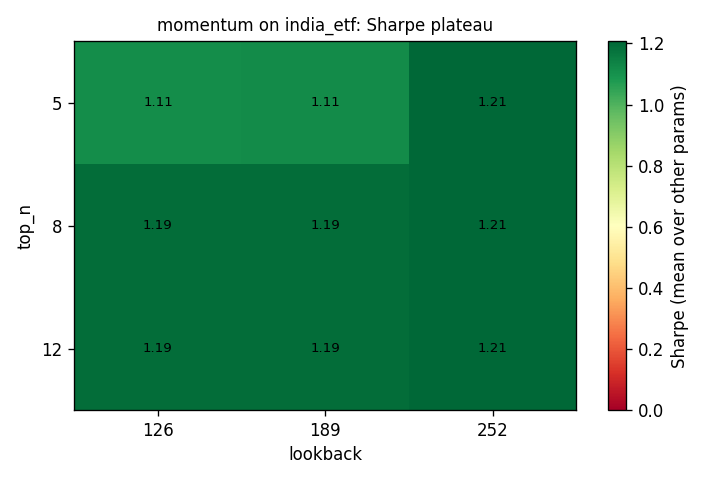

Top 5 parameter sets (full period):

|   lookback |   skip |   top_n | regime_filter   |   sharpe |   sharpe_h1 |   sharpe_h2 | is_default   |
|-----------:|-------:|--------:|:----------------|---------:|------------:|------------:|:-------------|
|        252 |      0 |       5 | False           |     1.3  |        1.28 |        1.31 | False        |
|        252 |     21 |      12 | False           |     1.27 |        1.28 |        1.25 | False        |
|        252 |     21 |       8 | False           |     1.27 |        1.28 |        1.25 | False        |
|        252 |      0 |      12 | False           |     1.27 |        1.28 |        1.25 | False        |
|        252 |      0 |       8 | False           |     1.27 |        1.28 |        1.25 | False        |

### trend

Walk-forward OOS (2018-01-01 to 2026-09-04): CAGR **10.75%**, Sharpe **1.15**, MaxDD **-11.47%**  |  benchmark same period: CAGR 10.1%, Sharpe 0.66, MaxDD -38.44%

| train     |   test | chosen                                         |   train_sharpe |   test_sharpe |   test_cagr_pct |   test_maxdd_pct |   default_test_sharpe |
|:----------|-------:|:-----------------------------------------------|---------------:|--------------:|----------------:|-----------------:|----------------------:|
| 2015-2017 |   2018 | {'fast': 50, 'slow': 250, 'max_weight': 0.2}   |           1.57 |         -0.95 |           -6.35 |           -11.28 |                 -1.09 |
| 2016-2018 |   2019 | {'fast': 20, 'slow': 100, 'max_weight': 0.34}  |           1.33 |          1.92 |           15.27 |            -5.91 |                  1.77 |
| 2017-2019 |   2020 | {'fast': 100, 'slow': 250, 'max_weight': 0.25} |           1.49 |          2.07 |           22.18 |            -9.06 |                  1.98 |
| 2018-2020 |   2021 | {'fast': 20, 'slow': 100, 'max_weight': 0.34}  |           1.49 |          1.78 |           22.95 |            -6.68 |                  2.16 |
| 2019-2021 |   2022 | {'fast': 20, 'slow': 200, 'max_weight': 0.25}  |           2.05 |         -0.44 |           -4.12 |            -9.83 |                 -0.53 |
| 2020-2022 |   2023 | {'fast': 100, 'slow': 150, 'max_weight': 0.34} |           1.62 |          1.93 |           17.29 |            -7.32 |                  2.03 |
| 2021-2023 |   2024 | {'fast': 50, 'slow': 100, 'max_weight': 0.34}  |           1.44 |          1.64 |           18.54 |            -6.05 |                  1.66 |
| 2022-2024 |   2025 | {'fast': 20, 'slow': 100, 'max_weight': 0.2}   |           1.34 |          1.88 |           12.43 |            -2.9  |                  0.9  |
| 2023-2025 |   2026 | {'fast': 20, 'slow': 150, 'max_weight': 0.34}  |           1.99 |          0.05 |           -0.15 |           -11.47 |                  0.45 |

Plateau: median_sharpe=1.2, best_sharpe=1.39, pct_grid_above_benchmark=100.0, half_to_half_rank_corr=-0.08, default_sharpe=1.2, default_rank_of_33=19

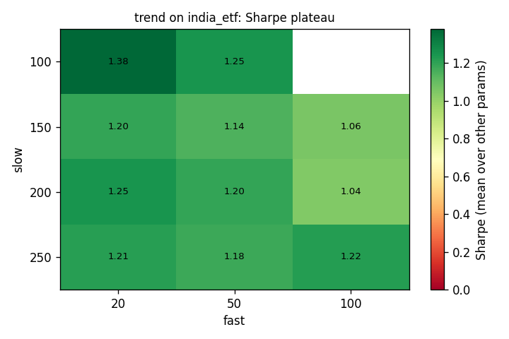

Top 5 parameter sets (full period):

|   fast |   slow |   max_weight |   sharpe |   sharpe_h1 |   sharpe_h2 | is_default   |
|-------:|-------:|-------------:|---------:|------------:|------------:|:-------------|
|     20 |    100 |         0.2  |     1.39 |        1.46 |        1.35 | False        |
|     20 |    100 |         0.25 |     1.38 |        1.48 |        1.32 | False        |
|     20 |    100 |         0.34 |     1.37 |        1.47 |        1.28 | False        |
|     50 |    100 |         0.34 |     1.26 |        1.29 |        1.23 | False        |
|     20 |    200 |         0.2  |     1.25 |        1.24 |        1.28 | False        |

### meanrev

Walk-forward OOS (2018-01-01 to 2026-09-04): CAGR **-3.23%**, Sharpe **-0.21**, MaxDD **-42.23%**  |  benchmark same period: CAGR 10.1%, Sharpe 0.66, MaxDD -38.44%

| train     |   test | chosen                                     |   train_sharpe |   test_sharpe |   test_cagr_pct |   test_maxdd_pct |   default_test_sharpe |
|:----------|-------:|:-------------------------------------------|---------------:|--------------:|----------------:|-----------------:|----------------------:|
| 2015-2017 |   2018 | {'oversold': 5, 'exit': 80, 'max_hold': 7} |           0.71 |         -0.1  |           -2.4  |           -12.35 |                 -0.94 |
| 2016-2018 |   2019 | {'oversold': 5, 'exit': 80, 'max_hold': 5} |           0.39 |         -1.12 |           -6.86 |            -8.91 |                 -1.12 |
| 2017-2019 |   2020 | {'oversold': 5, 'exit': 80, 'max_hold': 5} |           0.1  |          0.34 |            3.41 |           -12.64 |                  0.57 |
| 2018-2020 |   2021 | {'oversold': 5, 'exit': 60, 'max_hold': 5} |           0.19 |          1.03 |           11.7  |            -9.04 |                 -0.24 |
| 2019-2021 |   2022 | {'oversold': 5, 'exit': 60, 'max_hold': 5} |           0.5  |         -0.92 |           -6.82 |           -11.81 |                 -1.44 |
| 2020-2022 |   2023 | {'oversold': 5, 'exit': 60, 'max_hold': 3} |           0.54 |         -1.38 |           -7.32 |            -8.93 |                 -1.65 |
| 2021-2023 |   2024 | {'oversold': 5, 'exit': 60, 'max_hold': 3} |           0.2  |         -1.48 |          -12.21 |           -12.49 |                 -0.74 |
| 2022-2024 |   2025 | {'oversold': 5, 'exit': 80, 'max_hold': 7} |          -0.17 |         -0.06 |           -2.59 |           -18.74 |                 -0.4  |
| 2023-2025 |   2026 | {'oversold': 5, 'exit': 80, 'max_hold': 7} |          -0.04 |         -0.15 |           -4.77 |           -19.63 |                 -1.25 |

Plateau: median_sharpe=-0.52, best_sharpe=0.04, pct_grid_above_benchmark=0.0, half_to_half_rank_corr=0.73, default_sharpe=-0.58, default_rank_of_27=16

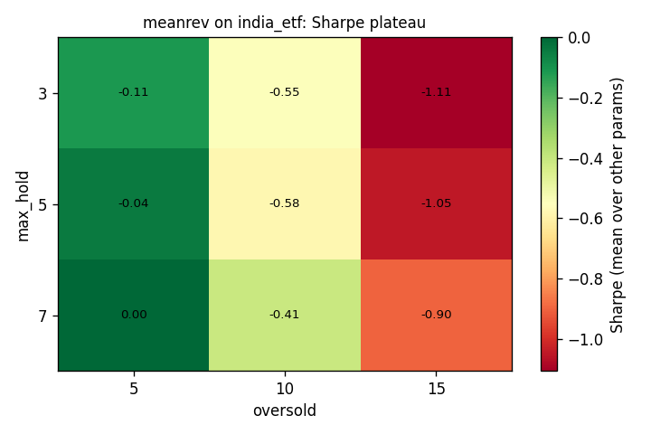

Top 5 parameter sets (full period):

|   oversold |   exit |   max_hold |   sharpe |   sharpe_h1 |   sharpe_h2 | is_default   |
|-----------:|-------:|-----------:|---------:|------------:|------------:|:-------------|
|          5 |     80 |          7 |     0.04 |        0.09 |       -0.01 | False        |
|          5 |     70 |          7 |     0.02 |        0.27 |       -0.19 | False        |
|          5 |     80 |          5 |    -0.03 |        0.27 |       -0.27 | False        |
|          5 |     60 |          5 |    -0.04 |        0.42 |       -0.4  | False        |
|          5 |     60 |          7 |    -0.06 |        0.22 |       -0.28 | False        |

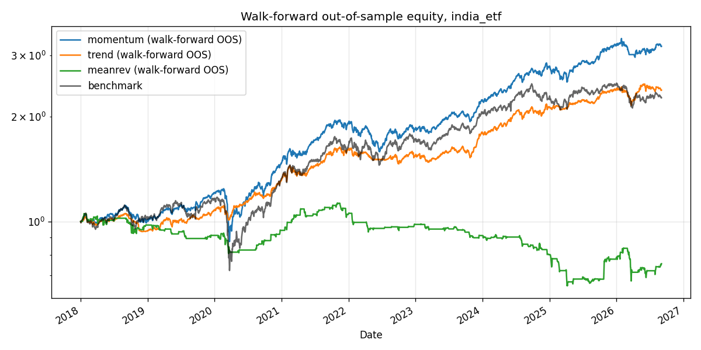

## Universe `us_core` (costs: us_alpaca)

### momentum

Walk-forward OOS (2018-01-02 to 2026-09-04): CAGR **16.69%**, Sharpe **0.85**, MaxDD **-31.15%**  |  benchmark same period: CAGR 14.74%, Sharpe 0.82, MaxDD -33.72%

| train     |   test | chosen                                                            |   train_sharpe |   test_sharpe |   test_cagr_pct |   test_maxdd_pct |   default_test_sharpe |
|:----------|-------:|:------------------------------------------------------------------|---------------:|--------------:|----------------:|-----------------:|----------------------:|
| 2015-2017 |   2018 | {'lookback': 252, 'skip': 21, 'top_n': 12, 'regime_filter': True} |           2.25 |         -0.06 |           -3    |           -19.1  |                 -0.16 |
| 2016-2018 |   2019 | {'lookback': 126, 'skip': 21, 'top_n': 5, 'regime_filter': True}  |           1.58 |          1.48 |           21.96 |           -10.26 |                  1.68 |
| 2017-2019 |   2020 | {'lookback': 126, 'skip': 21, 'top_n': 5, 'regime_filter': True}  |           1.49 |          0.65 |           15.39 |           -25.71 |                  0.7  |
| 2018-2020 |   2021 | {'lookback': 189, 'skip': 0, 'top_n': 8, 'regime_filter': False}  |           1.16 |          1.61 |           32.57 |            -7.16 |                  1.26 |
| 2019-2021 |   2022 | {'lookback': 189, 'skip': 0, 'top_n': 12, 'regime_filter': False} |           1.53 |         -0.35 |          -10.42 |           -19.85 |                 -1.38 |
| 2020-2022 |   2023 | {'lookback': 252, 'skip': 0, 'top_n': 5, 'regime_filter': False}  |           0.94 |          1.96 |           42.11 |            -8.87 |                  2.21 |
| 2021-2023 |   2024 | {'lookback': 126, 'skip': 0, 'top_n': 8, 'regime_filter': True}   |           1.37 |          2.39 |           61.92 |           -13.78 |                  2.25 |
| 2022-2024 |   2025 | {'lookback': 252, 'skip': 21, 'top_n': 5, 'regime_filter': True}  |           1.66 |         -0.27 |           -8.27 |           -31.15 |                  0.38 |
| 2023-2025 |   2026 | {'lookback': 189, 'skip': 0, 'top_n': 12, 'regime_filter': False} |           1.89 |          1.09 |           17.1  |           -11.96 |                  0.62 |

Plateau: median_sharpe=1.17, best_sharpe=1.33, pct_grid_above_benchmark=100.0, half_to_half_rank_corr=-0.01, default_sharpe=1.06, default_rank_of_36=36

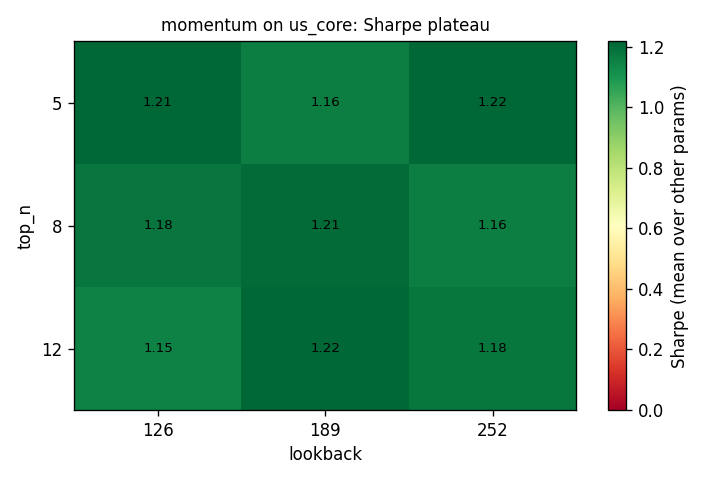

Top 5 parameter sets (full period):

|   lookback |   skip |   top_n | regime_filter   |   sharpe |   sharpe_h1 |   sharpe_h2 | is_default   |
|-----------:|-------:|--------:|:----------------|---------:|------------:|------------:|:-------------|
|        252 |      0 |       5 | False           |     1.33 |        1.39 |        1.28 | False        |
|        252 |      0 |       5 | True            |     1.28 |        1.36 |        1.2  | False        |
|        189 |      0 |      12 | True            |     1.28 |        1.25 |        1.31 | False        |
|        189 |      0 |       8 | False           |     1.28 |        1.35 |        1.21 | False        |
|        126 |      0 |       5 | True            |     1.27 |        1.36 |        1.19 | False        |

### trend

Walk-forward OOS (2018-01-02 to 2026-09-04): CAGR **15.51%**, Sharpe **1.06**, MaxDD **-17.21%**  |  benchmark same period: CAGR 14.74%, Sharpe 0.82, MaxDD -33.72%

| train     |   test | chosen                                         |   train_sharpe |   test_sharpe |   test_cagr_pct |   test_maxdd_pct |   default_test_sharpe |
|:----------|-------:|:-----------------------------------------------|---------------:|--------------:|----------------:|-----------------:|----------------------:|
| 2015-2017 |   2018 | {'fast': 100, 'slow': 200, 'max_weight': 0.25} |           1.74 |         -0.07 |           -2.61 |           -17.21 |                  0.02 |
| 2016-2018 |   2019 | {'fast': 20, 'slow': 100, 'max_weight': 0.34}  |           0.99 |          1.87 |           19.96 |            -8.12 |                  1.99 |
| 2017-2019 |   2020 | {'fast': 50, 'slow': 100, 'max_weight': 0.34}  |           1.38 |          1.39 |           30.36 |           -14.54 |                  1.63 |
| 2018-2020 |   2021 | {'fast': 100, 'slow': 200, 'max_weight': 0.34} |           1.16 |          2.28 |           35.25 |            -5.33 |                  2.35 |
| 2019-2021 |   2022 | {'fast': 100, 'slow': 200, 'max_weight': 0.34} |           1.9  |         -0.2  |           -4.69 |           -15.82 |                 -0.45 |
| 2020-2022 |   2023 | {'fast': 100, 'slow': 200, 'max_weight': 0.25} |           1.26 |          1.78 |           24.54 |            -7.74 |                  2.08 |
| 2021-2023 |   2024 | {'fast': 50, 'slow': 150, 'max_weight': 0.2}   |           1.35 |          1.95 |           26.09 |            -8.09 |                  1.95 |
| 2022-2024 |   2025 | {'fast': 20, 'slow': 150, 'max_weight': 0.2}   |           1.21 |          0.96 |           12.68 |           -16.5  |                  1.14 |
| 2023-2025 |   2026 | {'fast': 20, 'slow': 100, 'max_weight': 0.2}   |           1.92 |          0.11 |            0.63 |            -7.08 |                  0.92 |

Plateau: median_sharpe=1.18, best_sharpe=1.3, pct_grid_above_benchmark=100.0, half_to_half_rank_corr=0.57, default_sharpe=1.29, default_rank_of_33=5

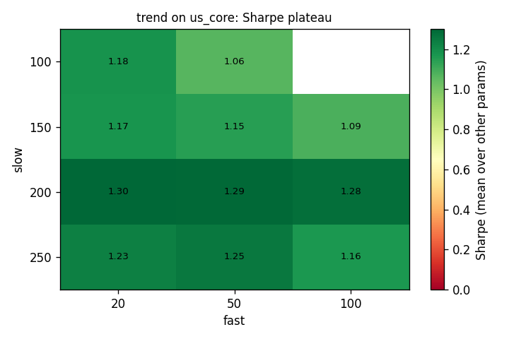

Top 5 parameter sets (full period):

|   fast |   slow |   max_weight |   sharpe |   sharpe_h1 |   sharpe_h2 | is_default   |
|-------:|-------:|-------------:|---------:|------------:|------------:|:-------------|
|     50 |    200 |         0.34 |     1.3  |        1.3  |        1.3  | False        |
|     20 |    200 |         0.2  |     1.3  |        1.26 |        1.35 | False        |
|     20 |    200 |         0.25 |     1.3  |        1.26 |        1.34 | False        |
|     20 |    200 |         0.34 |     1.3  |        1.28 |        1.34 | False        |
|     50 |    200 |         0.25 |     1.29 |        1.29 |        1.3  | True         |

### meanrev

Walk-forward OOS (2018-01-02 to 2026-09-04): CAGR **15.19%**, Sharpe **0.86**, MaxDD **-27.31%**  |  benchmark same period: CAGR 14.74%, Sharpe 0.82, MaxDD -33.72%

| train     |   test | chosen                                      |   train_sharpe |   test_sharpe |   test_cagr_pct |   test_maxdd_pct |   default_test_sharpe |
|:----------|-------:|:--------------------------------------------|---------------:|--------------:|----------------:|-----------------:|----------------------:|
| 2015-2017 |   2018 | {'oversold': 10, 'exit': 80, 'max_hold': 7} |           1.75 |          0.39 |            5.98 |           -17.04 |                 -0.02 |
| 2016-2018 |   2019 | {'oversold': 10, 'exit': 80, 'max_hold': 7} |           1.15 |          1.71 |           27.81 |            -9.83 |                  1.61 |
| 2017-2019 |   2020 | {'oversold': 5, 'exit': 80, 'max_hold': 7}  |           1.16 |          0.68 |           13.98 |           -27.31 |                  1.09 |
| 2018-2020 |   2021 | {'oversold': 15, 'exit': 80, 'max_hold': 3} |           1.57 |          1.25 |           24.41 |            -9.48 |                  1.53 |
| 2019-2021 |   2022 | {'oversold': 15, 'exit': 70, 'max_hold': 3} |           1.87 |         -0.61 |          -14.16 |           -22.05 |                 -0.57 |
| 2020-2022 |   2023 | {'oversold': 15, 'exit': 70, 'max_hold': 3} |           1.24 |          0.75 |           10.12 |           -13.1  |                  2.34 |
| 2021-2023 |   2024 | {'oversold': 10, 'exit': 70, 'max_hold': 7} |           1.06 |          1.86 |           34.38 |            -7.03 |                  1.17 |
| 2022-2024 |   2025 | {'oversold': 5, 'exit': 60, 'max_hold': 7}  |           1.12 |          0.72 |            9.69 |           -13.7  |                  0.25 |
| 2023-2025 |   2026 | {'oversold': 5, 'exit': 60, 'max_hold': 7}  |           1.71 |          1.8  |           42.76 |            -7.73 |                  2.76 |

Plateau: median_sharpe=0.99, best_sharpe=1.29, pct_grid_above_benchmark=77.8, half_to_half_rank_corr=0.26, default_sharpe=1.05, default_rank_of_27=10

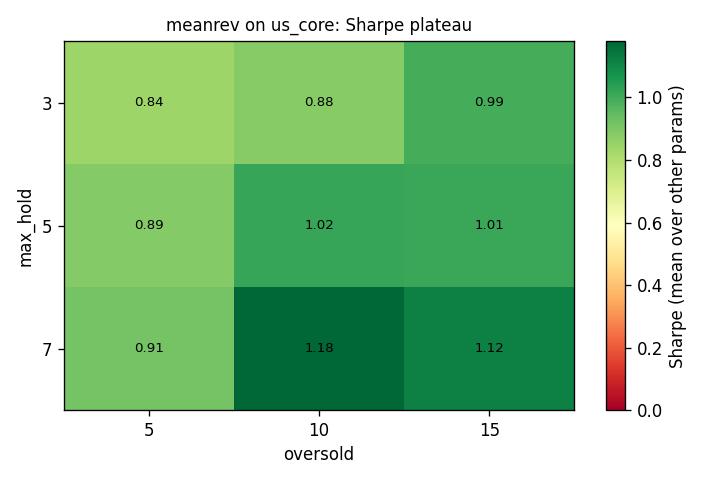

Top 5 parameter sets (full period):

|   oversold |   exit |   max_hold |   sharpe |   sharpe_h1 |   sharpe_h2 | is_default   |
|-----------:|-------:|-----------:|---------:|------------:|------------:|:-------------|
|         10 |     70 |          7 |     1.29 |        1.26 |        1.33 | False        |
|         15 |     80 |          7 |     1.16 |        1.19 |        1.14 | False        |
|         10 |     80 |          7 |     1.16 |        1.28 |        1.07 | False        |
|         15 |     70 |          7 |     1.12 |        1.18 |        1.08 | False        |
|         15 |     80 |          3 |     1.1  |        1.32 |        0.87 | False        |

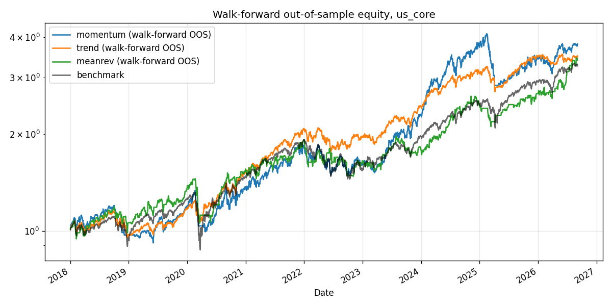

## How to read this

* **OOS Sharpe** is the only number that matters. It was never optimised.
* **% grid > bench** and **grid median Sharpe**: how much of the parameter space beats the benchmark. Broad hill = robust; single spike = curve-fit.
* **half/half rank corr**: Spearman correlation of parameter rankings between the first and second half of history. Near 0 means parameter choice is noise.
* **default rank**: where our shipped default parameters sit in the grid. If it's #1 out of 36, be suspicious of how they were chosen.